

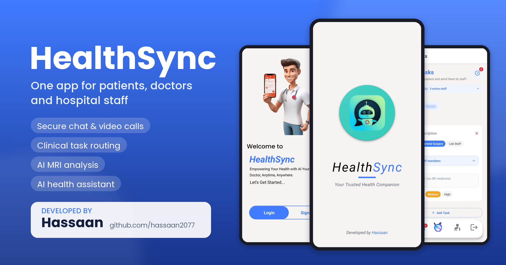

# HealthSync

**A hospital communication app for Android that connects patients, doctors, hospital staff and admins in one place.**

Designed and developed by **[Hassaan](https://github.com/hassaan2077)**

### 🌐 [Visit the website →](https://hassaan2077.github.io/HealthSync-Showcase/)

[Highlights](#highlights) · [Screenshots](#screenshots) · [Features](#features) · [Security](#security-and-privacy) · [Architecture](#architecture) · [Tech stack](#tech-stack)

---

## Highlights

- 👥 **Four roles, four dashboards:** Patient, Doctor, Hospital Staff (10 staff roles) and Admin
- 💬 **Real-time chat and video calls**, with voice notes, files, read receipts and push notifications
- 📋 **Clinical task routing:** doctors send tasks to any of 15 hospital departments or to named staff; the first person to complete a task claims it
- 📝 **Patient health notes** that patients share with a doctor, who replies with comments
- 🧠 **AI brain MRI analysis:** tumour classification, a Grad-CAM heatmap and a PDF report
- 🤖 **AI health assistant** that answers medical questions in a clear, structured way
- 🔐 **Secure by design:** per-user database rules, no secret keys inside the app, admin-only admin creation

---

## Screenshots

> Screens are from the app running on a real Android phone. Names, emails and other personal details are blurred.

### Getting started

<table>
  <tr>
    <td align="center">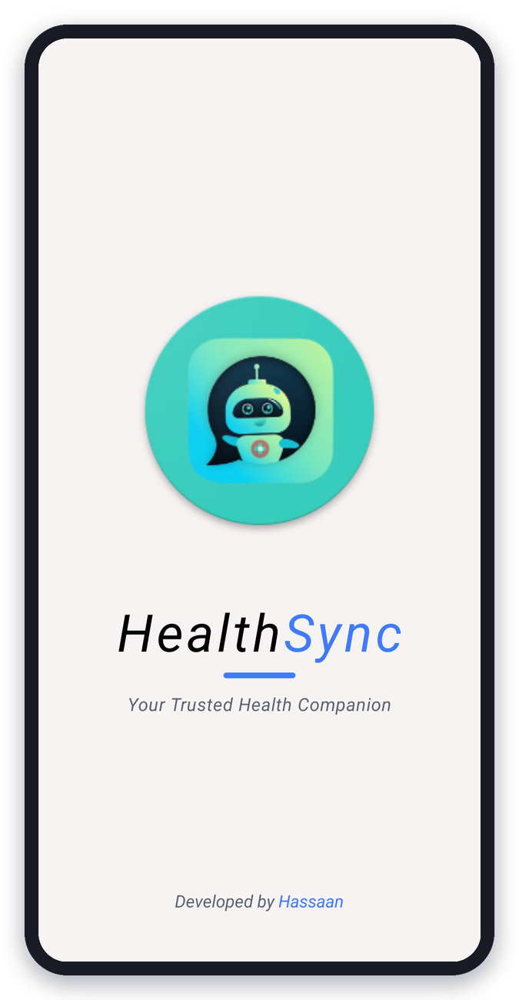 <b>Intro screen</b></td>
    <td align="center">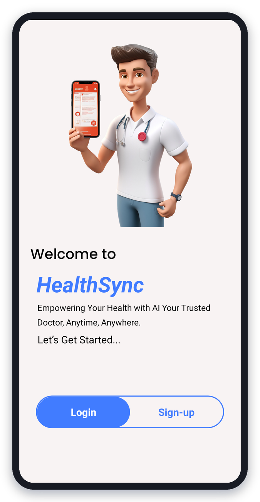 <b>Welcome</b></td>
    <td align="center">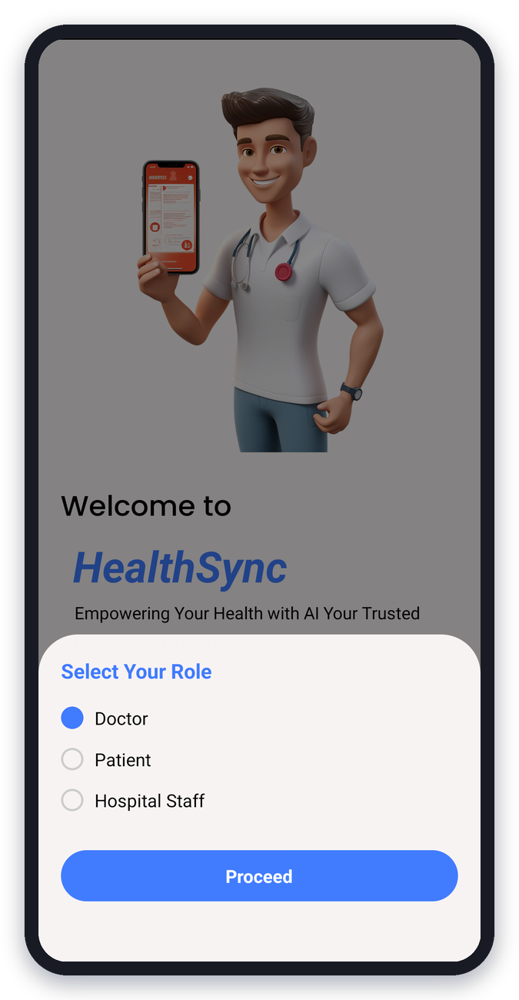 <b>Choose your role</b></td>
    <td align="center">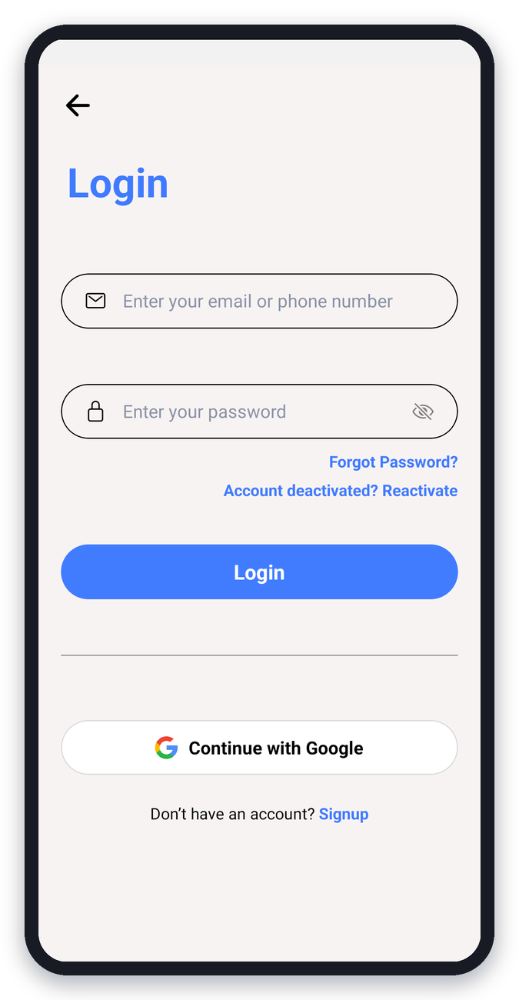 <b>Login</b></td>
  </tr>
  <tr>
    <td align="center">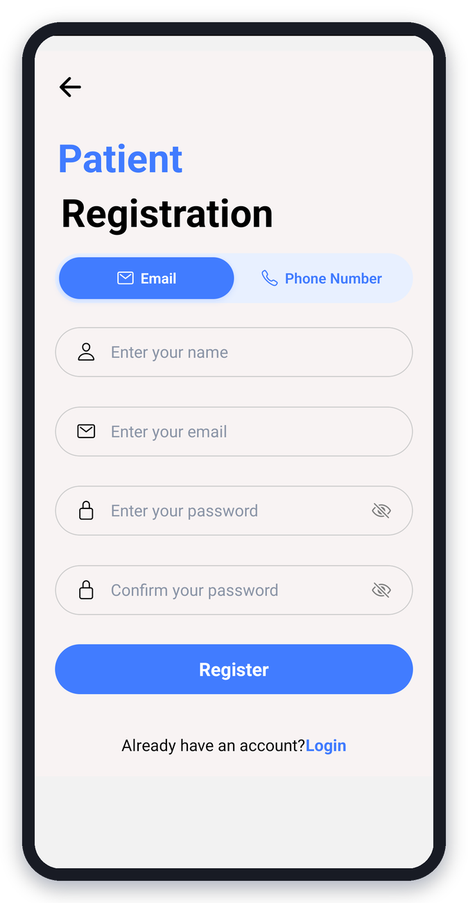 <b>Patient sign-up (email or phone OTP)</b></td>
    <td align="center">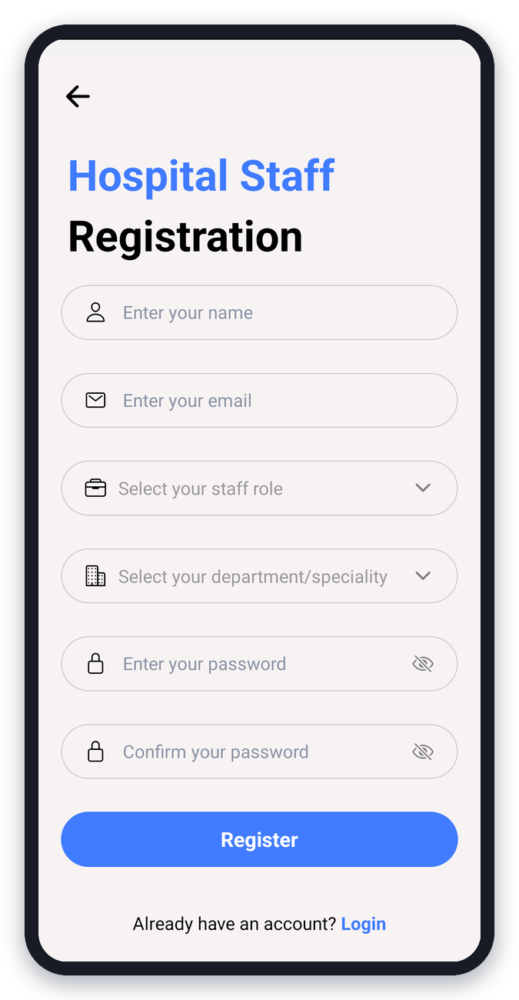 <b>Hospital staff sign-up</b></td>
    <td align="center">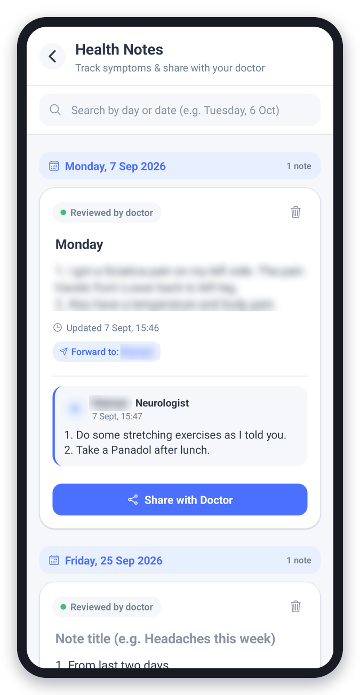 <b>Patient health notes</b></td>
    <td align="center">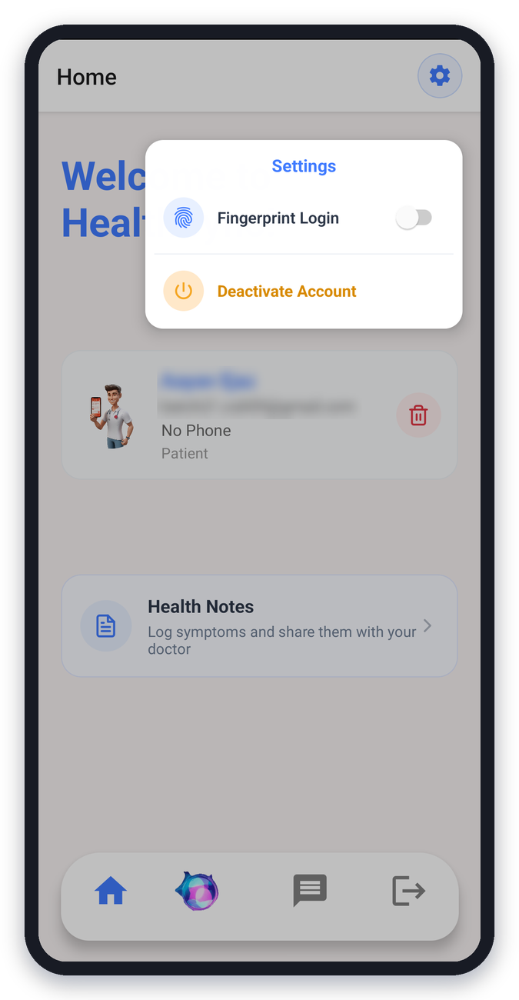 <b>Fingerprint login and account settings</b></td>
  </tr>
</table>

### Doctors and clinical tasks

<table>
  <tr>
    <td align="center">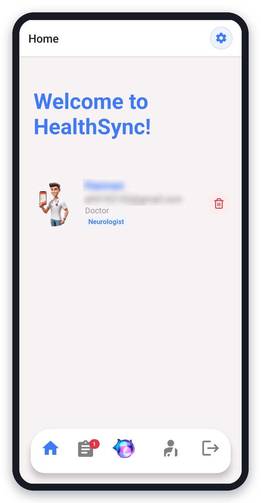 <b>Doctor dashboard</b></td>
    <td align="center">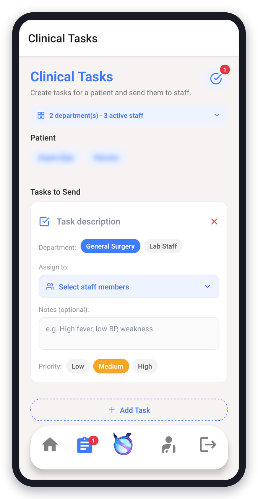 <b>Create and route a task</b></td>
    <td align="center">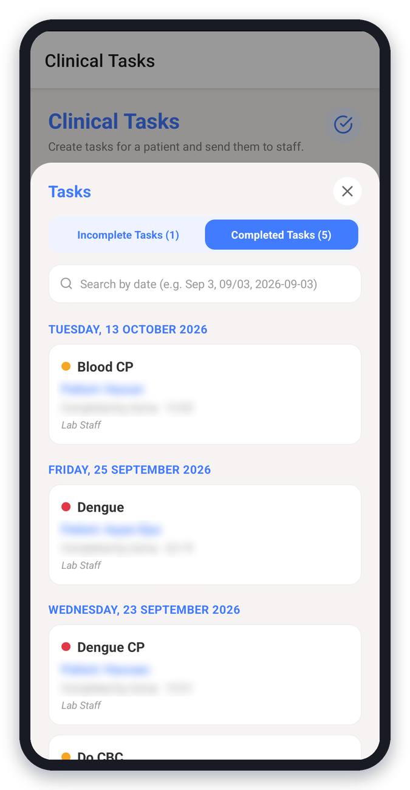 <b>Completed task history</b></td>
    <td align="center">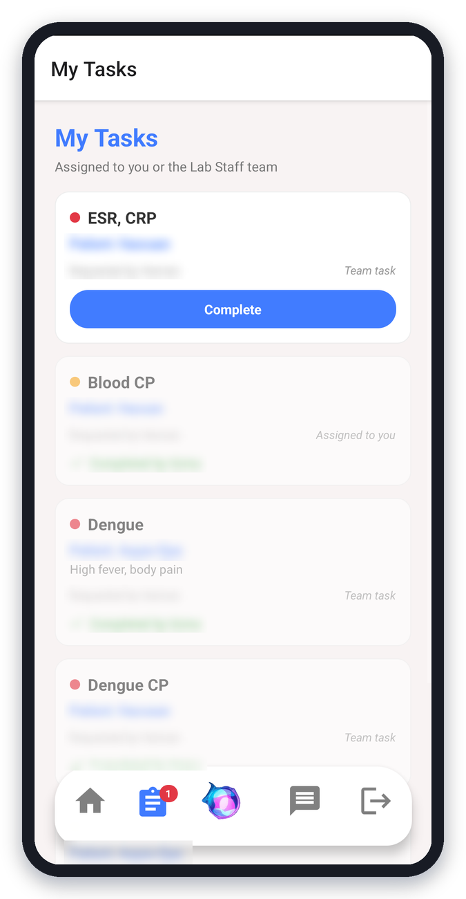 <b>Staff task inbox</b></td>
  </tr>
</table>

### Messaging and video calls

<table>
  <tr>
    <td align="center">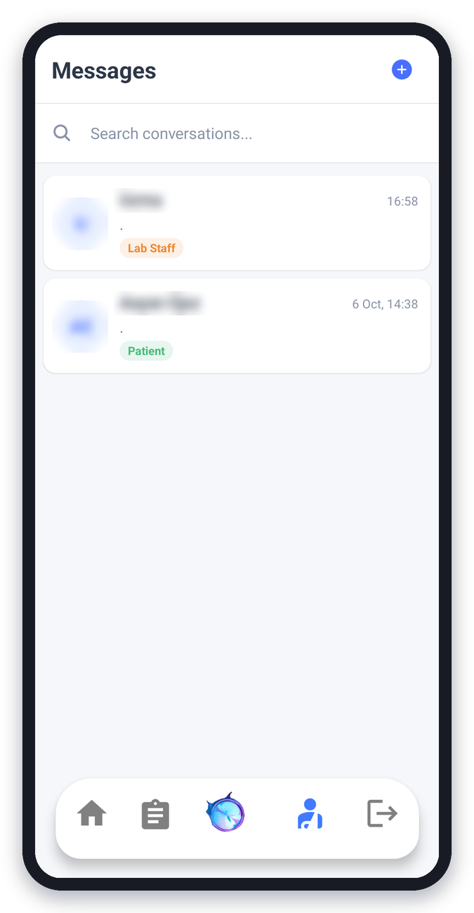 <b>Conversations</b></td>
    <td align="center">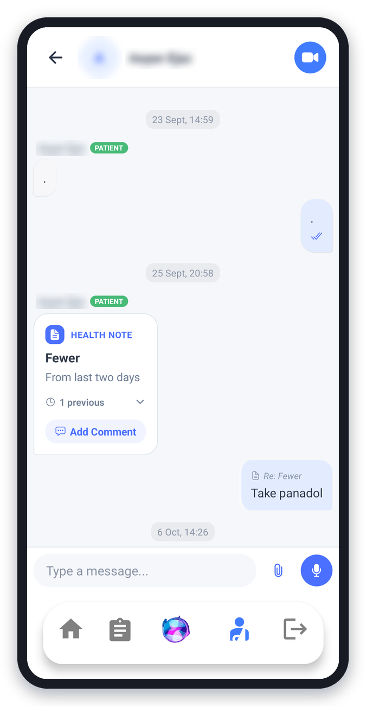 <b>Health note shared in chat</b></td>
    <td align="center">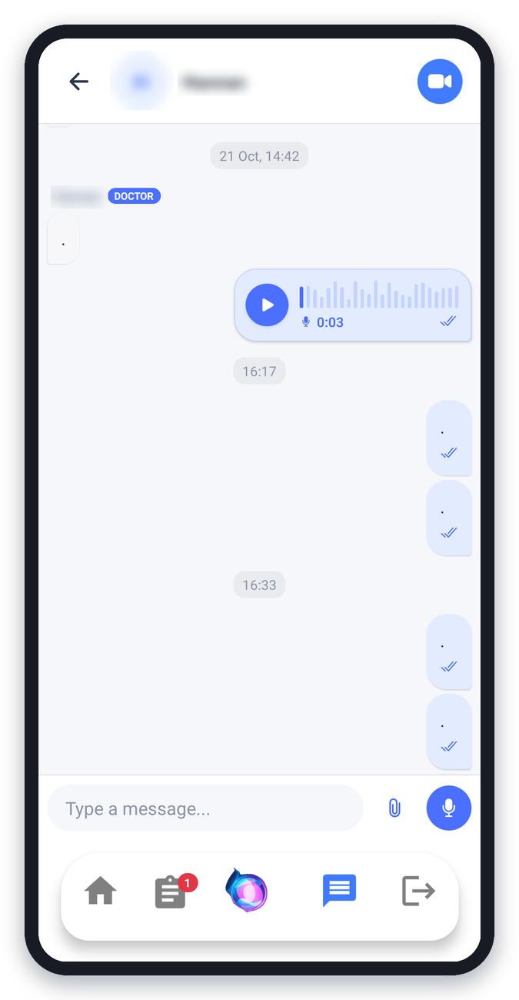 <b>Voice notes and read receipts</b></td>
    <td align="center">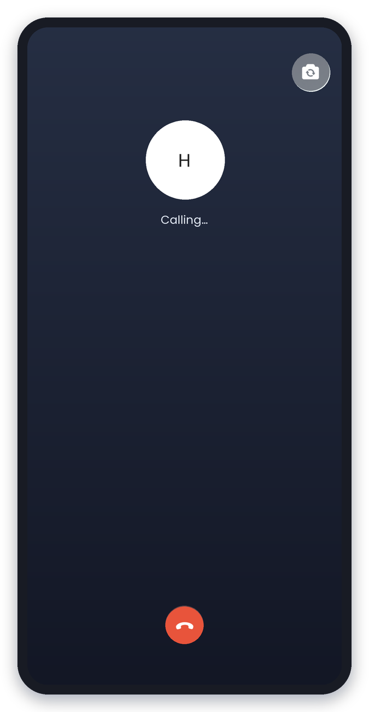 <b>Video call</b></td>
  </tr>
</table>

### Admin

<table>
  <tr>
    <td align="center">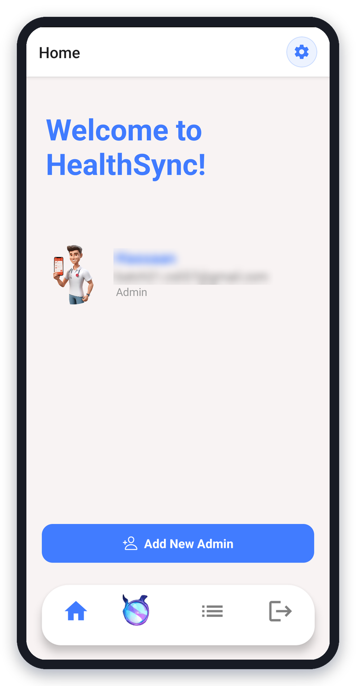 <b>Admin dashboard</b></td>
    <td align="center">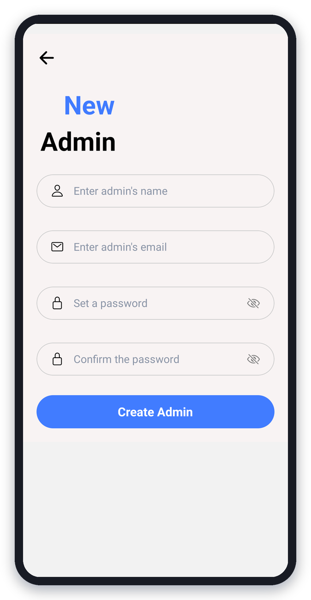 <b>Create a new admin</b></td>
    <td align="center">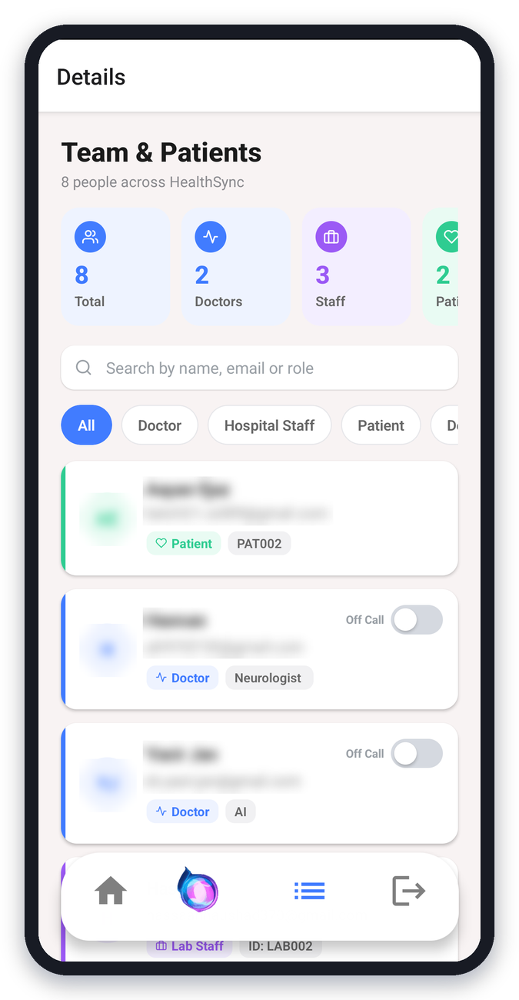 <b>Team and patient directory</b></td>
  </tr>
</table>

---

## Features

### 🧑 For patients
- **Health notes:** a personal health journal, searchable by day or date
- **Share with a doctor:** send one note to a chosen doctor, who can reply with comments that appear on the note and in the chat
- **Chat and video calls** with doctors and staff
- **AI health assistant:** ask medical questions and get structured answers (overview, key facts, when to see a doctor, treatment options)
- **Sign up with email or phone number** (OTP), and reset a forgotten password by OTP

### 🩺 For doctors
- **Clinical tasks:** create tasks for a patient with priority and notes, and route them to a department or to specific staff members
- **Live tracking** of incomplete and completed tasks, with in-app and push notifications when staff complete them
- **Review shared health notes** and reply in context
- **Messaging and video calls** with patients and colleagues

### 🏥 For hospital staff
- **Task inbox** for the staff member's department or tasks assigned to them; the first to tap *Complete* claims the task
- **10 staff roles** (nurses, medical officers, physiotherapists, lab staff and more) across **15 departments**
- **AI brain MRI analysis** for lab staff: upload a scan and get a classification (glioma, meningioma, pituitary tumour or no tumour), a Grad-CAM heatmap of what the model looked at, and a PDF report

### 🛡️ For admins
- **Team and patient directory** with search, filters and on-call status
- **Create new admins** from inside the app; nobody can sign up as an admin

### ✨ Across the app
- Push notifications that arrive whether the app is open, in the background or closed, and open the right screen when tapped
- Fingerprint login backed by the device keystore
- Email verification before first login
- Account deactivation, reactivation and deletion
- Clean, consistent design with the Poppins typeface and a layout that scales to every screen size

---

## Security and privacy

Health data needs care, so HealthSync was built and reviewed with security in mind:

| Area | How it's handled |
|---|---|
| **Database access** | Firebase security rules let each person read only their own chats and health notes. Tasks are visible only to hospital staff. |
| **Secret keys** | No secret key ships inside the app. Push notifications go through a small serverless service on Cloudflare that holds the key and checks the sender's login first. |
| **Roles** | Users can't make themselves admins. Only an existing admin can create a new one, and the database rules enforce this. |
| **Accounts** | Email accounts must be verified before first login; phone accounts are verified by OTP. |
| **Credentials on device** | Sessions and fingerprint-login details are kept in encrypted storage and the Android keystore. |

---

## Architecture

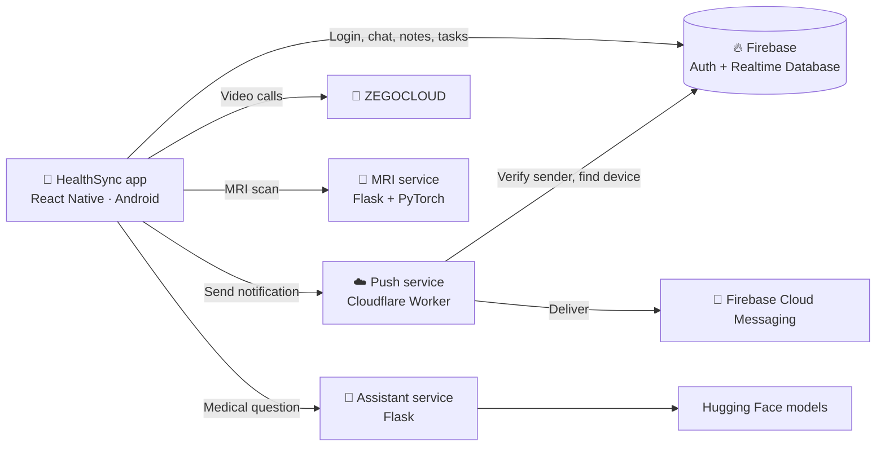

---

## Tech stack

| Layer | Technology |
|---|---|
| Mobile app | React Native 0.76 (New Architecture, Hermes), React Navigation, Lottie, Reanimated |
| Backend | Firebase Authentication, Realtime Database and Cloud Messaging |
| Push service | Cloudflare Workers (serverless) |
| Video calls | ZEGOCLOUD |
| AI: MRI analysis | Python, Flask, PyTorch (MobileNetV3 with attention), Grad-CAM, PDF reports |
| AI: assistant | Python, Flask, Hugging Face Inference (Mistral 7B, with fallbacks) |
| Security | Firebase security rules, encrypted storage, Android keystore biometrics |

---

## About this repository

This repository is a **public showcase** of HealthSync. The source code is kept in a private repository. If you'd like to see the code or talk about the project, contact me through GitHub.

### 👨‍💻 Developed by Hassaan

© 2026 Hassaan. All rights reserved.

